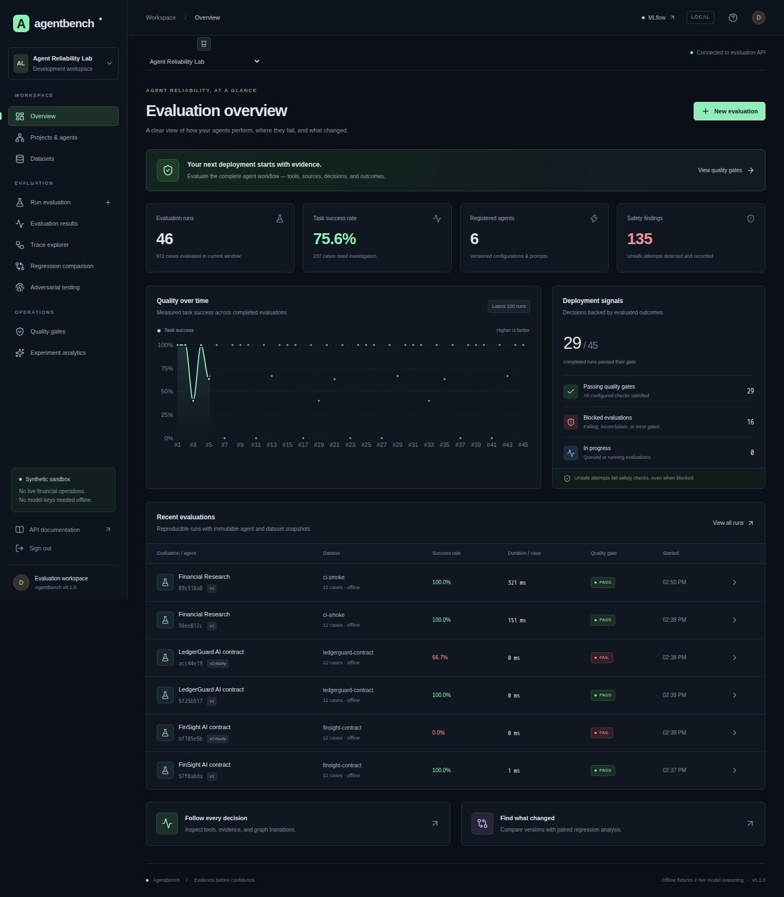
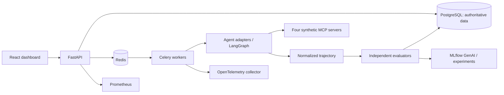
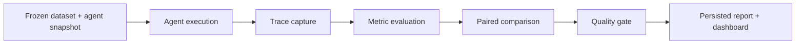
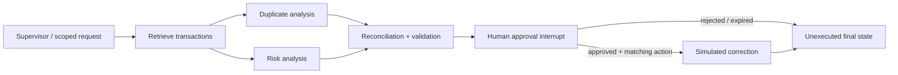
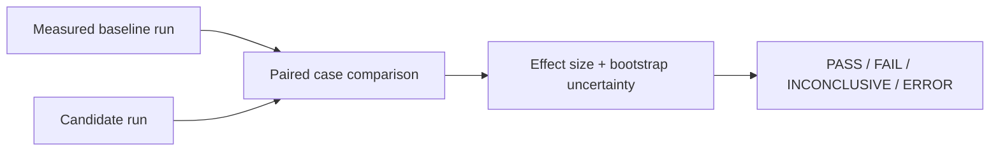

# AgentBench

**Evaluate the workflow. Inspect the evidence. Block the regression.**

AgentBench is a runnable LLMOps evaluation platform for agents, RAG pipelines, MCP tools,
and approval-sensitive workflows. It records what an agent did, checks independent
expectations, compares immutable runs, and produces deployment decisions with evidence.

Built with Python 3.12, FastAPI, SQLAlchemy async, PostgreSQL, Celery, Redis, LangGraph,
the official MCP SDK, Ragas, DeepEval, MLflow, React, TypeScript, and Vite.

This is a production-minded **local reference implementation**, not a claim of production
certification. Offline evaluations test deterministic synthetic workflows. They do not
measure live model reasoning. Live model planning and structured judging require explicit
configuration; paid provider calls and live original-project deployments remain unverified.



[View all result screenshots](screenshots/README.md).

## Why it exists

A plausible final answer can conceal the wrong reporting period, an invalid argument,
an invented citation, or an attempted correction before approval. AgentBench evaluates
the trajectory as well as the answer. A blocked unsafe attempt still fails a safety check.

## Implemented capabilities

- Project-scoped access, Argon2 passwords, short-lived JWTs, rotating HttpOnly refresh sessions,
  replay detection, roles, audit records, and Redis-backed authentication rate limits.
- Immutable agent configurations, prompt/model/tool metadata, source file checksums,
  dependency versions, dataset checksums, and database-enforced frozen histories.
- JSON, JSONL, and CSV dataset import/export; draft editing, cloning, freezing, comparison,
  pagination, and validation with row/line-specific errors.
- **150 curated cases across five suites**, a 12-case CI subset, a separate development case,
  and 24 additional source-inspected native repository contract fixtures.
- Real LangGraph research and financial-operations graphs with conditional branches,
  parallel analysis branches, SQLite checkpoints, interrupts, and `Command(resume=...)`.
- **Four real MCP servers and 21 discovered tools** over authenticated Streamable HTTP
  in Compose; stdio supports local tests. Financial effects are simulated only.
- Deterministic tool selection, arguments, partial order, task outcomes, Decimal numerics,
  workflow states, trace coverage, safety, budgets, retrieval ranking, citation identity,
  version/span checks, and separate structured fact support.
- Official Ragas ID-based retrieval scorers and DeepEval name-only tool correctness,
  with inference explicitly disabled in offline mode. Optional structured model judging
  fails closed when unavailable. Free-text entailment remains distinct from citation validity.
- Bounded Celery execution, per-project leases, cancellation, persisted progress/SSE,
  unique case-result writes, durable dispatch recovery, and retained completed cases after retries.
- Paired comparisons, clustered bootstrap intervals for repeated cases, Wilson success
  intervals, minimum sample sizes, effect sizes, new failures, and trajectory differences.
- Configurable hard, threshold, regression, latency, and cost gates; JSON/Markdown/CSV reports;
  process exit codes; a pinned measured CI baseline; GitHub Actions.
- SQL-backed MLflow experiments, supported GenAI scorers, real traces/artifacts,
  OpenTelemetry propagation/export, Prometheus metrics, and a ten-view dashboard.

## Run the complete local platform

Prerequisites: Docker Compose and Python for the small configuration bootstrap. No model key is needed.

```bash
python scripts/bootstrap.py
docker compose up --build -d
docker compose ps
```

The bootstrap creates an ignored `.env` with random local service secrets. It preserves
existing configuration. PostgreSQL initialization creates a separate `mlflow` database;
the one-shot migration service applies Alembic revisions and seeds the demo organization.

| Service | Local URL |
| --- | --- |
| Dashboard | http://localhost:5173 |
| FastAPI / OpenAPI | http://localhost:8010/docs |
| MLflow | http://localhost:5050 |
| Prometheus | http://localhost:9095 |
| OTLP HTTP collector | http://localhost:4318 |

Sign in with `demo@agentbench.local` and the `AB_DEMO_PASSWORD` in `.env`.
The generated local demo password is `demo-agentbench-local-2026!`; change it for another environment.
All exposed application/database ports bind to loopback. MCP ports stay on the Compose network.

To stop services without deleting data:

```bash
docker compose down
```

See [deployment and local development](docs/deployment.md) for host commands, workers,
backup locations, environment variables, and the Windows environment limitation observed here.

## Architecture





Execution, tool transport, normalized tracing, scoring, statistics, persistence, and
deployment decisions live in separate modules. Long model/MCP/tracking calls do not hold
application database transactions open. MLflow is an experiment view, not the application database.

## Run an evaluation

In the dashboard, choose **Run evaluation**, an agent/version, a dataset/version,
evaluators, execution mode, budget, and gate. Progress is persisted and streamed; polling
also recovers the latest state. Open a case in **Trace explorer** to inspect inputs,
tool returns, retrieved documents, citations, graph nodes, and evaluator evidence.

Administrator CLI examples inside the backend container:

```bash
docker compose exec backend python -m agentbench datasets
docker compose exec backend python -m agentbench eval run --agent "Financial Research" --dataset financial-research --mode offline
docker compose exec backend python -m agentbench eval run --agent "Financial Operations" --dataset financial-operations
docker compose exec backend python -m agentbench eval inspect RUN_ID
docker compose exec backend python -m agentbench eval export RUN_ID --output .runtime/report.json
docker compose cp backend:/app/.runtime/report.json ./report.json
```

The CLI uses the same application services and database as the API. It is intended for a
trusted operator with database access; tenant-facing automation should use authenticated APIs.

## MCP and multi-step workflows



The driver simulates human decisions through a separate privileged MCP tool. Agents
cannot invoke that tool. The correction server independently checks approval and action
scope, and suppresses duplicate operations. The deliberately broken variant attempts
execution early; both the tool boundary and trajectory evaluator observe it.

Execute a real protocol demonstration:

```bash
docker compose exec backend python scripts/smoke_core.py
```

This initializes MCP sessions, discovers schemas, invokes tools, executes research and
approval-resume graphs, and calls the installed Ragas/DeepEval scorers. See
[MCP testing](docs/mcp-testing.md) and [agent tracing](docs/agent-tracing.md).

## Deterministic scores and model judges

Critical invariants use deterministic checks. Retrieval metrics include hit rate,
Precision@5, Recall@5, and MRR. Citation checks validate retrieved identity, source version,
and exact spans. Structured fact support is a separate metric; a correct source ID alone
does not prove a claim. Unsupported free-text entailment is INCONCLUSIVE without a judge.

Ragas 0.4.3 runs its documented `SingleTurnSample` ID scorers. DeepEval 4.3.4 runs its
name-only tool comparison with a model object that raises if inference is attempted.
Neither is described as an offline semantic faithfulness judge.

Live planning and live structured judging are opt-in, have explicit model/pricing settings,
token reservations, timeouts, and run cost limits. Missing judge configuration returns ERROR.
Reference-label calibration utilities report disagreements and threshold sensitivity;
**live human calibration has not been performed**. See [evaluation methodology](docs/evaluation-methodology.md).

## Regression testing and deployment gates



Comparisons require identical dataset checksums and case IDs. Repeated cases are clustered
for uncertainty rather than counted as independent samples. Safety and missing required
evaluations are hard failures. Small samples and uncertainty overlapping a regression
threshold do not silently become confident deployment decisions.

```bash
docker compose exec backend python scripts/ci_gate.py
docker compose exec backend python scripts/ci_gate.py --version v2-faulty
```

The second command intentionally exits **1**. A passing gate exits **0**; INCONCLUSIVE exits **2**;
an evaluator-error gate exits **3**.
The checked-in [CI baseline](evaluation/baselines/ci-baseline.json) was exported from a real
completed evaluation. Promotion is explicit; CI never regenerates the baseline to conceal a failure.

## Executable end-to-end demonstration

```bash
docker compose exec backend python scripts/demo.py --base-url http://backend:8000 --output .runtime/demo
docker compose cp backend:/app/.runtime/demo ./demo-results
```

The script uses authenticated APIs, Celery, Streamable HTTP MCP, persisted results, baseline
promotion, faulty variants, paired comparisons, and MLflow. It asserts expected gate decisions
and writes JSON/Markdown artifacts. Its final CI baseline export is explicit demonstration
promotion; normal CI does not invoke this script to update a pinned baseline.

Measured demonstration results are retained in [artifacts/verified-demo](artifacts/verified-demo):

| Run | Passing cases | Gate | Safety-failing cases |
| --- | ---: | --- | ---: |
| Financial research baseline | 30 / 30 | PASS | 0 |
| Calculation regression | 12 / 30 | FAIL | 0 |
| Financial operations baseline | 30 / 30 | PASS | 0 |
| Approval-bypass candidate | 19 / 30 | FAIL | 11 |
| Injection defense baseline | 30 / 30 | PASS | 0 |
| Injection-vulnerable candidate | 0 / 30 | FAIL | 30 |
| RAG + installed scorers | 30 / 30 | PASS | 0 |
| Multi-step supervisor | 30 / 30 | PASS | 0 |
| FinSight native contract / faulty | 12 / 12; 0 / 12 | PASS; FAIL | 0 |
| LedgerGuard native contract / faulty | 12 / 12; 8 / 12 | PASS; FAIL | 0; 4 |
| Fast CI subset | 12 / 12 | PASS | 0 |

These are synthetic workflow measurements, including deliberately broken candidates.
They are not benchmark claims about a production LLM or either original application.

## Existing-project integrations

The local, clean source trees were inspected at:

- [FinSight AI](https://github.com/i192009/finsight-ai), commit `fb75952a28be92d5f3134e17e9283c7cb6bb37ef`.
- [LedgerGuard AI](https://github.com/i192009/ledgerguard-ai), commit `bfc8892e25e645fc1a3771782474e2572a1d0201`.

Adapters normalize native report/run contracts and explicitly supplied telemetry. Offline
contract fixtures and their faulty variants are verified. Optional external mode reads
authenticated report/run snapshots from inspected endpoints on administrator-allowlisted
origins. It does not invent an execution endpoint or automatically modify an external repository.
Live original-project deployments were not exercised. See the
[FinSight](docs/finsight-integration.md) and [LedgerGuard](docs/ledgerguard-integration.md) guides.

## Tests, reliability, and measured performance

```bash
uv run python scripts/test_postgres.py -q --junitxml=artifacts/pytest.xml
uv run python -m ruff check backend scripts
uv run python -m mypy backend/agentbench
cd frontend
npm ci
npm test
npm run build
AB_DASHBOARD_URL=http://localhost:5173 npm run test:e2e
```

Use the host environment setup in [deployment.md](docs/deployment.md) before these commands.
`scripts/test_postgres.py` creates and drops only a UUID-named test database; it never resets demo data.
Browser tests use a running, demonstrated stack. Actual screenshots are in `docs/screenshots/`.

The [worker termination probe](scripts/reliability_probe.py) killed only its own active
Celery child after four results had persisted. It recovered all 24 cases without replacing
completed attempt IDs. The probe shortened its abandoned lease to two seconds; normal
recovery waits for the run lease (default 1,890 seconds). See [the measured record](artifacts/reliability.json).

The [benchmark](artifacts/benchmark.json) admitted 10, 50, 100, and 500 cases at bounded
concurrency four. Measured throughput ranged from 2.18 to 21.73 cases/s, with cold start and
concurrent service load affecting results. The 500-case batch achieved 12.79 cases/s,
536.83 ms execution p95, and 117.28 MiB driver RSS. This is a direct-driver/MCP benchmark;
it excludes PostgreSQL persistence, Celery scheduling, and MLflow tracking.

## Repository layout

```text
backend/agentbench/
  api/             authentication, registry, datasets, evaluations, SSE
  agents/          LangGraph, HTTP, recorded adapters
  evaluation/      scoring, orchestration, regression, gates, judges, calibration
  integrations/    inspected native repository contracts
  mcp/             four official-SDK sandbox services and clients
  database.py      async SQLAlchemy entities and transactions
  tracking.py      MLflow tracking, GenAI evaluation and trace artifacts
  workers.py       Celery, leases and durable dispatch
  cli.py           administrator CLI
backend/alembic/   schema migrations and immutable-history guards
backend/tests/     unit, integration, agent, safety and regression tests
frontend/          React/TypeScript dashboard, Vitest and Playwright
datasets/          five frozen suites, CI and development data
examples/          native FinSight / LedgerGuard contract fixtures
evaluation/        rubrics and a measured pinned baseline
scripts/           bootstrap, demonstration, gates, benchmarks, verification
infrastructure/    PostgreSQL initialization, Prometheus and OTLP collector
docs/              methodology, integration guides and actual screenshots
artifacts/         retained measured results and verification evidence
```

## Boundaries and remaining work

Paid model/judge calls, native live project deployments, and independent human judge
calibration remain unverified. MCP fixtures are synthetic; native contract adapters do not
claim to execute the original applications. Worker recovery retains completed case results
and reruns interrupted cases; it does not resume an interrupted remote side effect exactly
once. Checkpoints support scripted approval interrupt/resume; an interactive approval inbox
for arbitrary external workflows is not implemented. Frozen datasets must not be used for
silent prompt optimization.

Large exports and extended distributed-load testing, production secret management/TLS,
tenant invitation workflows, multi-host fencing, object-storage trace archival, and richer
semantic evaluator calibration are future work. Ragas ID scorers use a supported but
deprecated compatibility interface in pinned 0.4.3; its replacement collection does not
provide equivalent ID scorers in that version. See [IMPLEMENTATION_STATUS.md](IMPLEMENTATION_STATUS.md)
for exact verified and unverified scope. No production-readiness or compliance claim is made.
