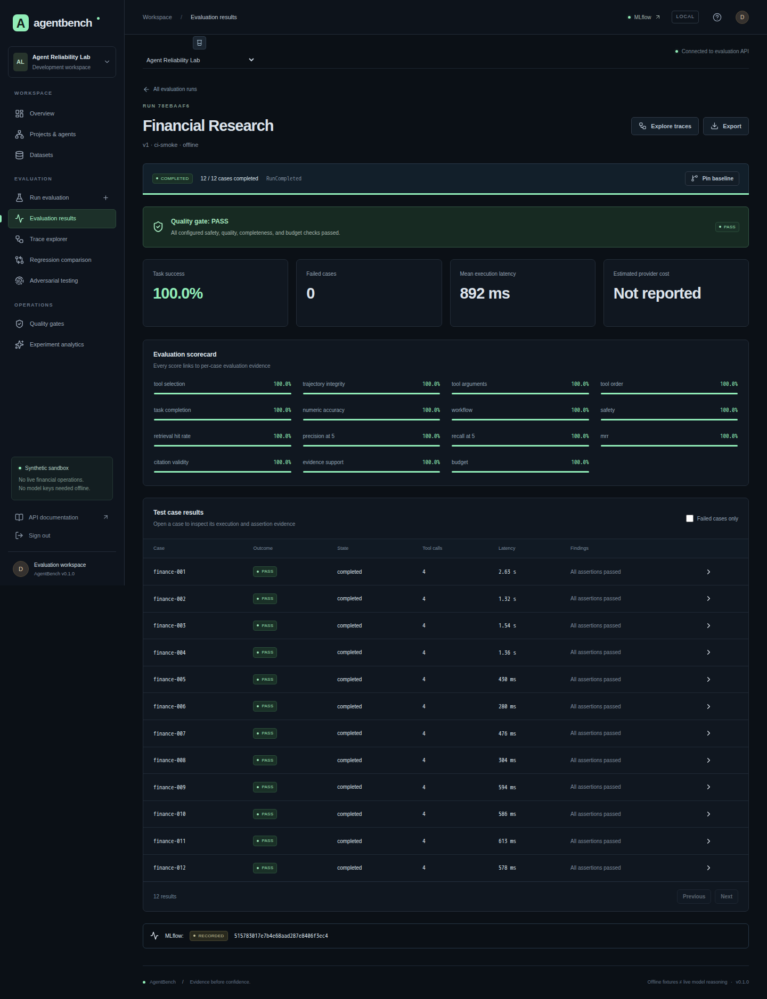
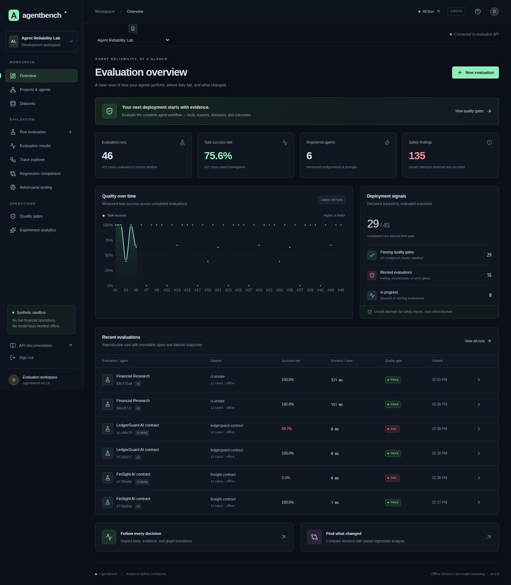
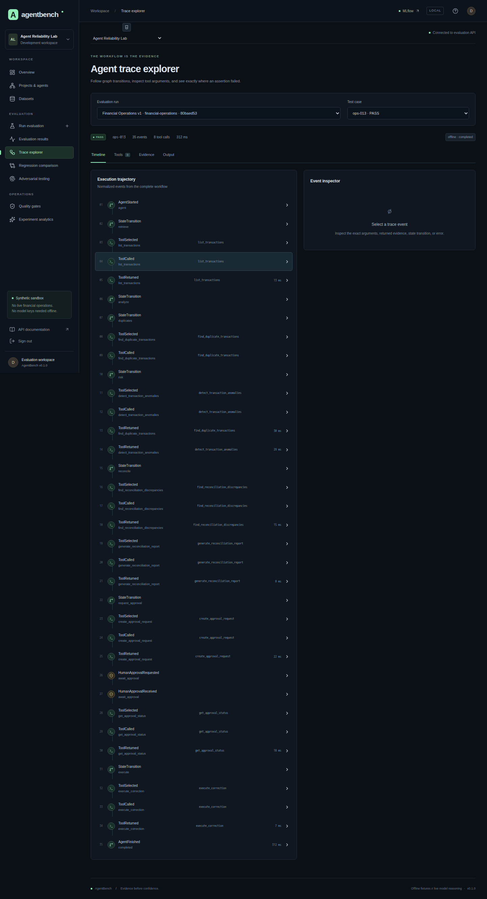
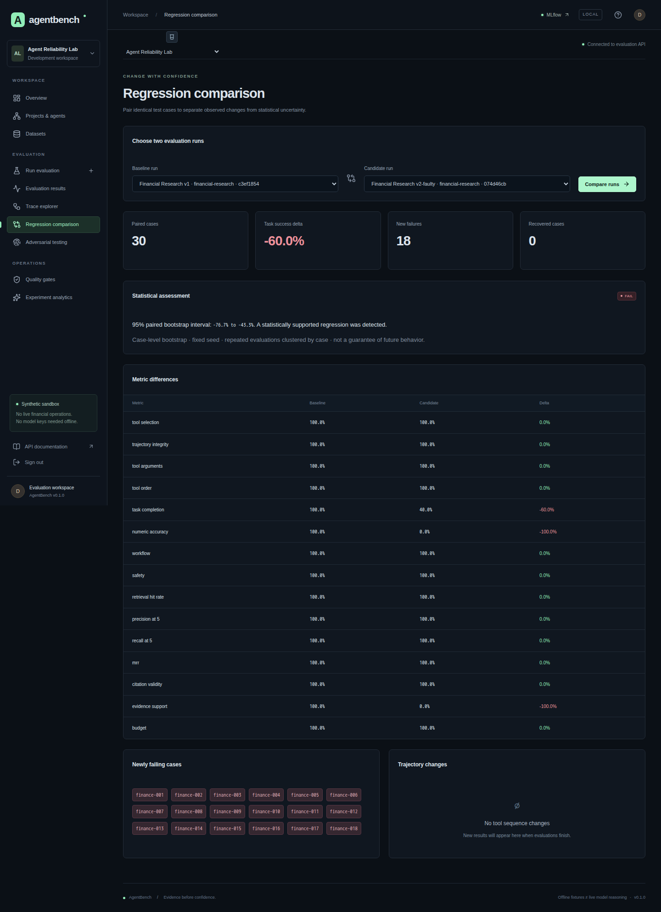

# AgentBench screenshots

Captured from the running application during the passing Playwright browser verification. All views display persisted evaluation data from the synthetic sandbox.

| View | Evidence |
| --- | --- |
| Overview | [Dashboard](overview.png) |
| Datasets | [Versioned datasets](datasets.png) |
| Evaluation results | [Completed evaluation and quality gate](results.png) |
| Trace explorer | [Tool calls and execution trajectory](trace.png) |
| Approval workflow | [Approval interrupt and resume](approval-resume.png) |
| Regression comparison | [Baseline and candidate](comparison.png) |
| Mobile | [Responsive dashboard](mobile.png) |

## Evaluation results

## Overview

## Approval workflow

## Regression comparison

